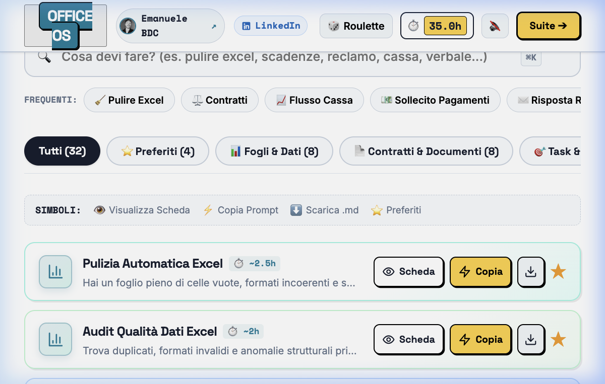
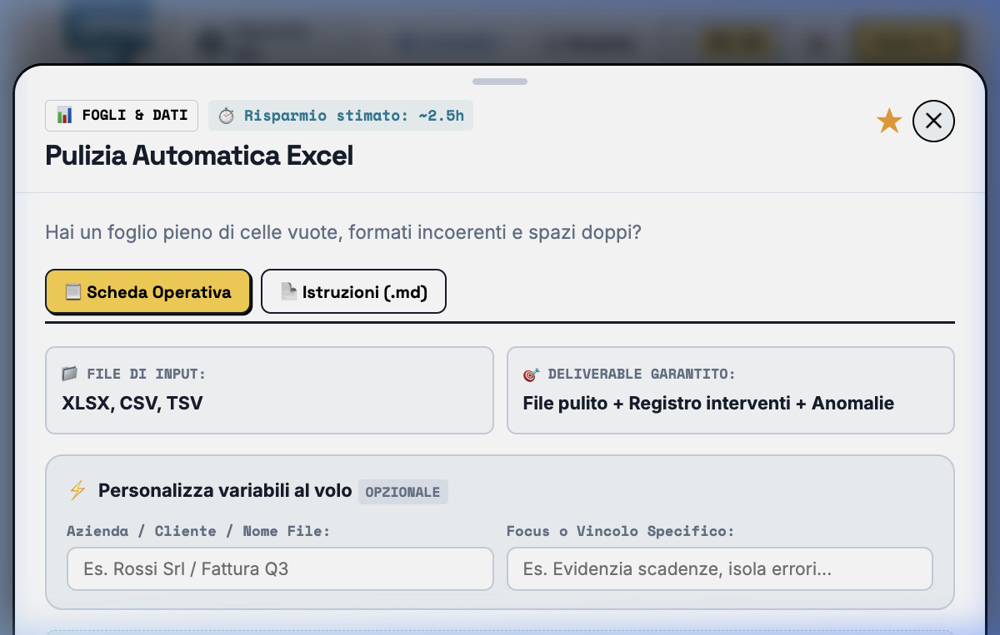
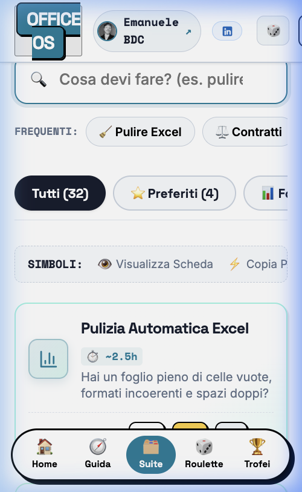

# Office OS — Local-First Workspace for Distraction-Free Daily Operations

<p align="center">
  
</p>

> **"Your daily office desk, distilled to pure speed."**  
> A lightweight, local-first operational dashboard for notes, tasks, client portals, and daily workflows. Zero cloud subscriptions, zero loading lag, 100% data sovereignty.

[](https://emaf205.com/ideas/office-os/)
[](https://github.com/emaf205/office-os)
[](LICENSE)

---

## ✦ The Genesis & Why This Exists

Modern productivity suites (Notion, Monday, Asana, Jira) have transformed into bloated, over-engineered corporate labyrinths. What should take three seconds—jotting down a phone call note, checking off a morning delivery, or opening a client dashboard—now requires waiting for spinning loaders, navigating multi-level workspace trees, and dodging subscription paywalls.

I engineered **Office OS** to reclaim operational peace of mind:
- **Instantaneous Execution**: Sub-30ms startup time.
- **Local-First Architecture**: Your tasks, quick notes, and links remain strictly in your browser's local sandbox. No unexpected cloud outages, no vendor lock-in.
- **Cognitive Clarity**: Swiss modernist typography, high-contrast visual cues, and zero visual clutter.

---

## ✦ Live Interface & Screenshots

<p align="center">
  
  
</p>

<p align="center">
  
  
</p>

---

## ✦ Key Operational Modules

1. **Daily Action Grid**:
   - High-density, keyboard-friendly checklist for daily non-negotiable tasks.
2. **Scratchpad & Fast Notes**:
   - Zero-friction scratchpad for quick phone memos, meeting takeaways, and prompt snippets.
3. **Curated Link Portals**:
   - Categorized launchpads for client portals, banking dashboards, AI workspaces, and cloud utilities.
4. **Data Sovereignty & Backups**:
   - Export your entire workspace state into a clean JSON file with one click, or import it back seamlessly.

---

## ✦ Technical Highlights

- **Pure Client-Side Web Architecture**: Vanilla HTML5, modern CSS variables, and ES6+ JavaScript.
- **Zero Dependencies**: No React, no framework build step, no npm overhead.
- **Offline Resilience**: Runs completely without an active internet connection once loaded.

---

## ✦ Quickstart & Offline Setup

```bash
# Clone the repository
git clone https://github.com/emaf205/office-os.git
cd office-os

# Unpack the complete package
unzip OFFICE_OS.zip -d app
open app/index.html
```

Or access the online build at:  
👉 **[https://emaf205.com/ideas/office-os/](https://emaf205.com/ideas/office-os/)**

---

## ✦ Author & Credits

Designed and maintained by **[Emanuele BDC](https://emaf205.com)** in Milan.  
Built for independent creators, consultants, and teams who value speed over bureaucracy.

Distributed under the **MIT License**. Free for personal and commercial productivity.
